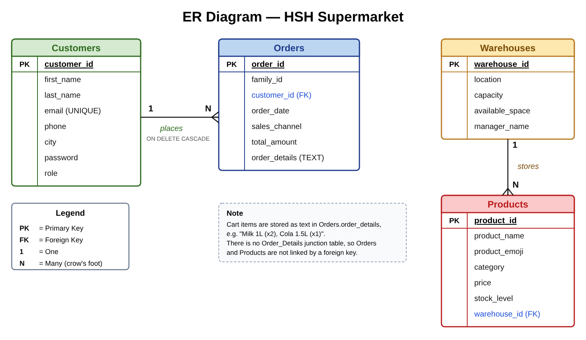

# HSH Supermarket — Online Supermarket Management System

> A web-based supermarket system (PHP + MySQL) with a customer storefront and an admin dashboard, replacing scattered spreadsheets with one central relational database.

## Live Demo

**http://hshsupermarket.infinityfreeapp.com** (hosted on InfinityFree)

## Overview

The retail company used to manage sales, customers and inventory in separate spreadsheets, which caused stock discrepancies and slow tracking. This project stores everything in a MySQL database and provides a GUI to manage customers, orders, products and warehouse stock.

When a customer confirms an order, the system saves the order, decreases the product's `StockLevel`, and increases the warehouse's `AvailableSpace` automatically.

## Features

**Customer**
- Register / log in
- Browse products by category (collapsible sections) and search by name
- Cart drawer with quantity controls and a total, then "Confirm & Place Order"
- View previous orders and edit profile

**Admin**
- Dashboard with total orders, revenue, customer count, categories and stock alerts
- Add, edit and delete products; update stock across warehouses
- View and manage all orders
- View, edit and delete customer accounts

Access is role-based (`Admin` / `Customer`).

## Tech stack

| Layer | Technology |
|-------|------------|
| Frontend | HTML, CSS, JavaScript |
| Backend | PHP (PDO) |
| Database | MySQL (managed with phpMyAdmin) |
| Server | Apache (XAMPP / AppServ) on localhost |

## Database

Four tables: `customers`, `orders`, `products`, `warehouses`.



- **Customers → Orders (1:N):** linked by `CustomerID`, with `ON DELETE CASCADE`.
- **Warehouses → Products (1:N):** linked by `WarehouseID`.
- **Cart items:** stored as text in `orders.OrderDetails` (e.g. `Milk 1L (x2)`), not in a separate junction table, to keep the structure simple.

The sample data (generated customers, 50 products, 5 warehouses) is in `database/supermarket.sql`.

## Project structure

```
├── database/
│   ├── supermarket.sql                # Schema + sample data (local MySQL)
│   └── supermarket_infinityfree.sql   # Same data, host-compatible collation
├── docs/
│   ├── er_diagram.png         # ER diagram
│   └── er_diagram.svg
├── src/
│   ├── index.php              # Login / register page
│   ├── dashboard.php          # Customer storefront
│   ├── my_orders.php          # Order history
│   ├── profile.php            # Profile page
│   ├── admin_dashboard.php    # Admin: products & stats
│   ├── admin_orders.php       # Admin: orders
│   ├── admin_customers.php    # Admin: customers
│   ├── process_order.php      # Saves an order and updates stock
│   ├── auth.php, login.php, logout.php
│   ├── update_profile.php, update_order_logic.php, delete_order.php
│   ├── db_config.php          # Database connection settings (edit this one)
│   ├── db_config.example.php  # Template for db_config.php
│   └── config.php             # Legacy config (not used by the main pages)
└── README.md
```

## Getting started (local)

1. Install XAMPP (or AppServ) and start **Apache** and **MySQL**.
2. Open phpMyAdmin, create a database named `supermarket`, and import `database/supermarket.sql`.
3. Copy the contents of `src/` into your server's web folder (e.g. `htdocs/supermarket/`).
4. Set your MySQL host, database name, username and password in `src/db_config.php` (all pages read it).
5. Open `http://localhost/supermarket/index.php`.

## Deploying online (InfinityFree, free)

1. Create an account at infinityfree.com and add a new website (you get a link like `yourname.infinityfreeapp.com`).
2. In the control panel open **MySQL Databases** and create a database. Note the host, database name, username and password.
3. Open phpMyAdmin from the panel, select the database, click **Import**, and upload `database/supermarket_infinityfree.sql` (same data, with a collation compatible with the host).
4. Copy `src/db_config.example.php` to `src/db_config.php` and fill in the details from step 2.
5. Upload everything in `src/` into the `htdocs` folder (File Manager or FileZilla) so that `index.php` sits directly inside `htdocs`.
6. Open your website link and log in.

Demo admin account: `halaaljafary@g.com` / `hala`. Change these credentials before any real use.

## Notes

- This is an academic project. Passwords are stored as plain text, which is not suitable for production (use `password_hash()` / `password_verify()` instead).
- Database credentials are hard-coded; do not publish real passwords.
